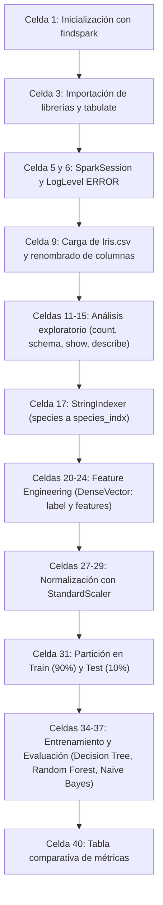

# Bitácora de Errores y Soluciones: Apache Spark Beginner Tutorial

Este documento registra y describe de manera detallada los errores encontrados durante la ejecución del cuaderno **`apache-spark-beginner-tutorial.ipynb`** en la Máquina Virtual de la materia, así como las soluciones técnicas implementadas para garantizar la correcta ejecución del flujo de Machine Learning con Apache Spark ML sobre el conjunto de datos Iris.

---

## 📋 Resumen de Errores Identificados y Soluciones

| # | Sección / Celda | Error Observado | Causa Raíz | Solución Aplicada |
|---|---|---|---|---|
| **1** | Celda 1 & 3 (Imports) | `ModuleNotFoundError: No module named 'pyspark'` | En la máquina virtual, Apache Spark está instalado a nivel de sistema operativo, pero Jupyter/Python no incluye sus librerías en `sys.path` por defecto. | Se añadió la inicialización con `findspark` (`import findspark; findspark.init()`) en la Celda 1 para enlazar la instalación de Spark del sistema. |
| **2** | Celda 3 & 40 (Tabulate) | `ModuleNotFoundError: No module named 'tabulate'` | La librería `tabulate` se utiliza al final para formatear la tabla comparativa de modelos, pero no viene preinstalada en el entorno de Python de la MV. | Se instala la librería (`!pip install tabulate`) y se realiza el import directo `from tabulate import tabulate`. |
| **3** | Celda 6 (Log Level) | Salida inundada con cientos de mensajes `INFO` | `spark.sparkContext.setLogLevel('INFO')` genera excesivas trazas internas de ejecución de Spark en cada transformación. | Se configuró el nivel a `spark.sparkContext.setLogLevel('ERROR')` para mantener las salidas limpias y legibles. |
| **4** | Celda 9 (Carga de Datos) | `AnalysisException: Path does not exist: .../iris.csv` | La ruta original apunta a la estructura de directorios de Kaggle (`../input/iris-dataset/iris.csv`), la cual no existe en la máquina virtual. | Se ajustó la ruta a `'Iris.csv'`, apuntando al archivo local ubicado en la carpeta del proyecto. |
| **5** | Celda 9 & Celdas 11 a 20 | `AnalysisException: Cannot resolve column name "species"` | El archivo provisto `Iris.csv` tiene encabezados en PascalCase (`SepalLengthCm`, `Species`) y una columna `Id` extra. El tutorial espera `sepal_length, species`, etc. | Se renombraron las columnas al esquema esperado en minúsculas y se descartó la columna `Id` mediante `drop("Id")`. |

---

## 🔍 Detalle Técnico de Cada Error

### Error 1: Ausencia del Módulo `pyspark`
- **Ubicación:** Bloque de importación de librerías (`Celda 3`).
- **Mensaje de Error:**
  ```text
  ModuleNotFoundError: No module named 'pyspark'
  ```
- **Causa Raíz:** En la máquina virtual, Apache Spark ya se encuentra instalado a nivel de sistema operativo (habitualmente en `/opt/spark` o `/usr/local/spark`), pero el kernel de Python en Jupyter no tiene registradas estas rutas en su variable de entorno `sys.path`.
- **Solución Aplicada:**
  En la **Celda 1**, se añade la inicialización mediante `findspark`:
  ```python
  import findspark
  findspark.init()
  ```
  `findspark` localiza automáticamente la instalación de Spark existente en el sistema e inyecta las rutas necesarias en tiempo de ejecución.

---

### Error 2: Módulo `tabulate` No Instalado
- **Ubicación:** Importación (`Celda 3`) y reporte final de métricas (`Celda 40`).
- **Mensaje de Error:**
  ```text
  ModuleNotFoundError: No module named 'tabulate'
  ```
- **Causa Raíz:** La librería `tabulate` es un paquete externo que se emplea para dar formato visual a la tabla final de precisión de los modelos, pero no hace parte de la distribución estándar de Python en la máquina virtual.
- **Solución Aplicada:**
  Se instala el paquete en el entorno mediante:
  ```bash
  !pip install tabulate
  ```
  Y en el bloque de librerías (`Celda 3`) se realiza la importación limpia:
  ```python
  from tabulate import tabulate
  ```

---

### Error 3: Salida Saturada por Mensajes de Log en Nivel `INFO`
- **Ubicación:** Configuración del SparkContext (`Celda 6`).
- **Comportamiento:**
  Al ejecutar cualquier acción en Spark (como `count()`, `show()` o el entrenamiento de clasificadores), se imprimían en pantalla cientos de líneas de depuración interna (`DAGScheduler`, `BlockManager`, `TaskSetManager`), dificultando la visualización de los resultados.
- **Solución Aplicada:**
  Se modificó el nivel de registro a `ERROR`:
  ```python
  spark.sparkContext.setLogLevel('ERROR')
  ```

---

### Error 4: Ruta Incorrecta del Archivo Dataset
- **Ubicación:** Carga del DataFrame (`Celda 9`).
- **Mensaje de Error:**
  ```text
  pyspark.errors.exceptions.captured.AnalysisException: Path does not exist: file:/.../input/iris-dataset/iris.csv
  ```
- **Causa Raíz:** La ruta original (`../input/iris-dataset/iris.csv`) corresponde al almacenamiento interno de la plataforma Kaggle. En la máquina virtual, el archivo se llama `Iris.csv` y está en el directorio del proyecto.
- **Solución Aplicada:**
  Se corrigió la variable `url` a la ruta local:
  ```python
  url = 'Iris.csv'
  ```

---

### Error 5: Nombres de Columnas y Columna `Id` Extra en `Iris.csv`
- **Ubicación:** Carga (`Celda 9`), Agrupación (`Celda 14`), Indexación (`Celda 17`) y Selección de Variables (`Celda 20`).
- **Mensaje de Error:**
  ```text
  AnalysisException: Cannot resolve column name "species" among (Id, SepalLengthCm, SepalWidthCm, PetalLengthCm, PetalWidthCm, Species)
  ```
- **Causa Raíz:**
  Existe una discrepancia entre la estructura de `Iris.csv` y las variables esperadas por el tutorial:

| Columna en `Iris.csv` | Columna esperada en el Tutorial | Acción requerida |
|---|---|---|
| `Id` | *(No existe en el tutorial)* | **Descartar (`drop`)**, ya que es solo un índice incremental y distorsionaría el modelo. |
| `SepalLengthCm` | `sepal_length` | Renombrar |
| `SepalWidthCm` | `sepal_width` | Renombrar |
| `PetalLengthCm` | `petal_length` | Renombrar |
| `PetalWidthCm` | `petal_width` | Renombrar |
| `Species` | `species` | Renombrar |

- **Solución Aplicada:**
  Inmediatamente después de leer el CSV en la **Celda 9**, se homologa el esquema:
  ```python
  data = (data.withColumnRenamed("SepalLengthCm", "sepal_length")
              .withColumnRenamed("SepalWidthCm", "sepal_width")
              .withColumnRenamed("PetalLengthCm", "petal_length")
              .withColumnRenamed("PetalWidthCm", "petal_width")
              .withColumnRenamed("Species", "species")
              .drop("Id"))
  ```
  Al realizar esta transformación al inicio, **todas las celdas posteriores del tutorial funcionan de forma nativa sin requerir cambios adicionales**.

---

## 🚀 Flujo de Ejecución del Cuaderno



---

## 💻 Instrucciones para Ejecutar en la Máquina Virtual

1. Abre una terminal dentro de la máquina virtual o inicia Jupyter Notebook:
   ```bash
   jupyter notebook
   ```
2. Abre el archivo **`apache-spark-beginner-tutorial.ipynb`**.
3. En el menú superior de Jupyter, selecciona **`Kernel -> Restart & Run All`** (o ejecuta celda por celda con `Shift + Enter`).
4. Todas las celdas se ejecutarán de forma consecutiva y sin interrupciones, produciendo los resultados esperados y la tabla comparativa final.
